<h1 align="center">DiagramKit</h1>

<p align="center">Report-grade diagrams for agents</p>

<p align="center">
  <a href="README.zh-CN.md">中文</a>
  ·
  <a href="#install">Install</a>
  ·
  <a href="#quick-start">Quick Start</a>
  ·
  <a href="#preview">Preview</a>
</p>

<p align="center">
  
  
  
</p>

<p align="center">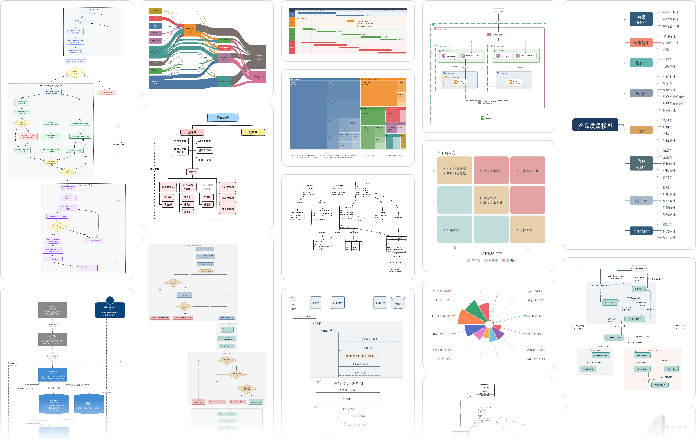</p>

---

Users provide material or say what they need to explain. The agent works out what the figure should say, and DiagramKit draws it: a diagram sized for a Word page or a slide, with its text at a readable size, as PNG, SVG and PDF.

DiagramKit draws structure, not numbers:

- How something works: a process with steps, decisions and exceptions; a treatment or production line; messages between parties.
- How something is organised: an organisation, a transaction structure, a contract system, a system's components, classes and tables.
- When and why: a schedule with dates, events over time, the causes of a problem, risks by likelihood and impact, where money comes from and goes.

Numeric trends, comparisons and distributions are a chart's work, not a diagram's.

## Preview

Every figure below was built from a semantic spec: what the boxes, the relations and the data are, with at most a hint of emphasis (a tone, a direction) and the page it goes on. No position, size or line route is written by hand: placing, wrapping and routing are DiagramKit's work.

They are set out by figure type, a few of each. A figure with no mark is in the default look on a Word page (one colour family for the whole document, Times New Roman with the machine's Song typeface); **report** marks `--style report`, each type's own colours; **hand-drawn** marks `--style notebook`. A name under a row opens that figure at full size; the `.json` of the same name in [`examples/gallery`](examples/gallery) is its spec.

<!-- showcase -->
<p align="center"><sub><a href="#flowcharts">Flowcharts</a> · <a href="#sequence-diagrams">Sequence diagrams</a> · <a href="#class-diagrams">Class diagrams</a> · <a href="#er-diagrams">ER diagrams</a> · <a href="#architecture-diagrams">Architecture diagrams</a> · <a href="#c4-model">C4 model</a> · <a href="#deal-and-contract-structures">Deal and contract structures</a> · <a href="#organisation-charts">Organisation charts</a> · <a href="#mind-maps">Mind maps</a> · <a href="#gantt-charts">Gantt charts</a> · <a href="#timelines">Timelines</a> · <a href="#fishbone-diagrams">Fishbone diagrams</a> · <a href="#risk-matrices-and-quadrant-charts">Risk matrices and quadrant charts</a> · <a href="#sankey-diagrams">Sankey diagrams</a> · <a href="#treemaps">Treemaps</a> · <a href="#pie-donut-and-rose-charts">Pie, donut and rose charts</a> · <a href="#radar-charts">Radar charts</a> · <a href="#user-journey-maps">User journey maps</a> · <a href="#kanban-boards">Kanban boards</a> · <a href="#requirement-diagrams">Requirement diagrams</a> · <a href="#one-figure-six-document-styles">One figure, six document styles</a></sub></p>

### Flowcharts

<p align="center">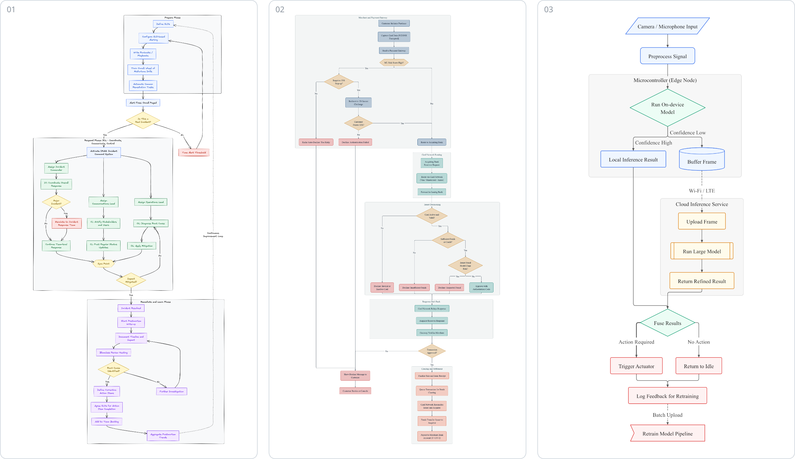</p>
<p align="center"><sub>01 <a href="examples/gallery/01-incident-response.png">Incident response · hand-drawn</a> · 02 <a href="examples/gallery/02-card-payment.png">Card payment and settlement</a> · 03 <a href="examples/gallery/03-edge-inference.png">Edge AI inference · report</a></sub></p>
<p align="center">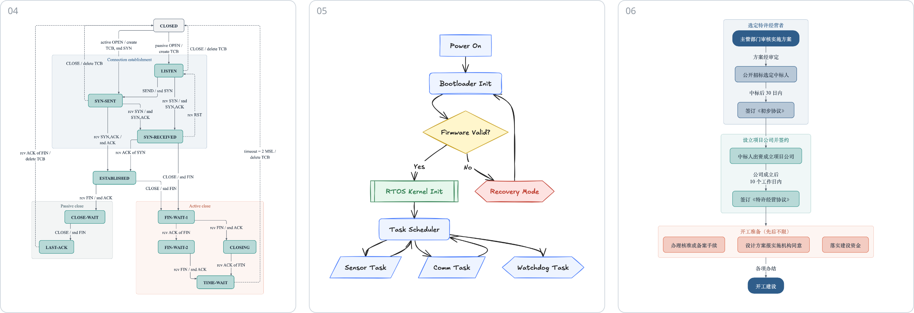</p>
<p align="center"><sub>04 <a href="examples/gallery/04-tcp-states.png">TCP state machine</a> · 05 <a href="examples/gallery/05-boot-sequence.png">Embedded boot sequence · hand-drawn</a> · 06 <a href="examples/gallery/06-phased-flow.png">Project implementation</a></sub></p>
<p align="center">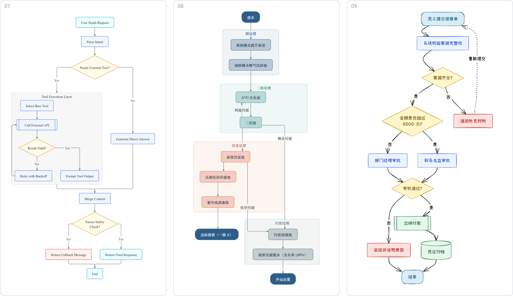</p>
<p align="center"><sub>07 <a href="examples/gallery/07-ai-agent.png">An AI agent · report</a> · 08 <a href="examples/gallery/08-treatment-process.png">Wastewater treatment</a> · 09 <a href="examples/gallery/09-approval-flow.png">Approval procedure · hand-drawn</a></sub></p>

### Sequence diagrams

<p align="center">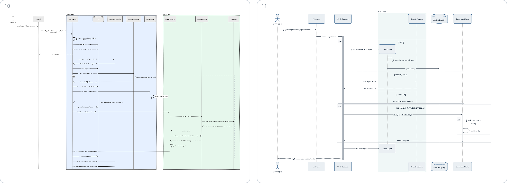</p>
<p align="center"><sub>10 <a href="examples/gallery/10-kubectl-apply.png">kubectl apply to a Pod · hand-drawn</a> · 11 <a href="examples/gallery/11-deployment.png">Continuous deployment</a></sub></p>
<p align="center">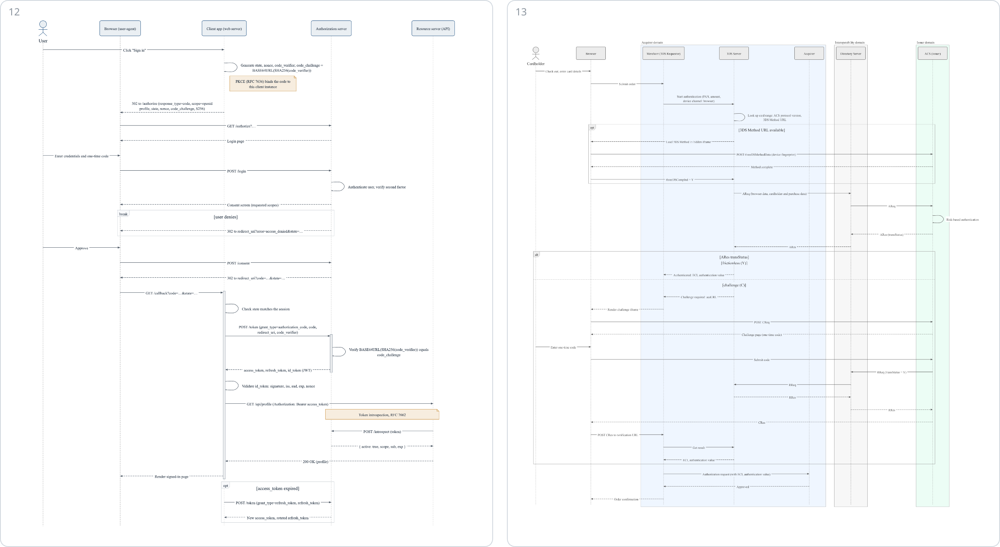</p>
<p align="center"><sub>12 <a href="examples/gallery/12-oauth.png">OAuth 2.0 code flow</a> · 13 <a href="examples/gallery/13-three-d-secure.png">EMV 3-D Secure · report</a></sub></p>
<p align="center">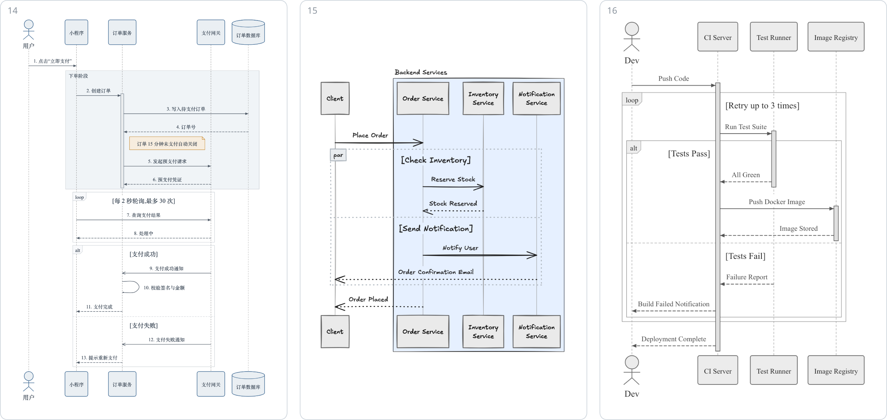</p>
<p align="center"><sub>14 <a href="examples/gallery/14-mini-program-payment.png">Mini-program order and payment</a> · 15 <a href="examples/gallery/15-parallel-calls.png">Parallel calls · hand-drawn</a> · 16 <a href="examples/gallery/16-ci-retries.png">CI run with retries · report</a></sub></p>

### Class diagrams

<p align="center">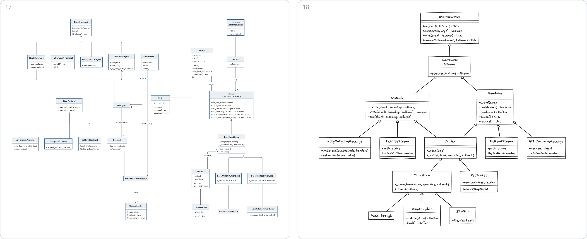</p>
<p align="center"><sub>17 <a href="examples/gallery/17-asyncio.png">asyncio</a> · 18 <a href="examples/gallery/18-streams.png">Stream classes · hand-drawn</a></sub></p>
<p align="center">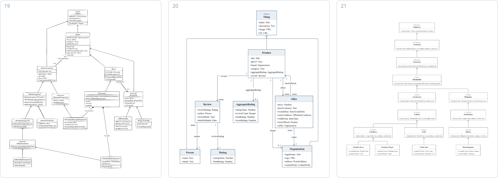</p>
<p align="center"><sub>19 <a href="examples/gallery/19-game-engine.png">Game engine objects · hand-drawn</a> · 20 <a href="examples/gallery/20-product-types.png">Product and reviews</a> · 21 <a href="examples/gallery/21-taxonomy.png">A taxonomy · report</a></sub></p>
<p align="center">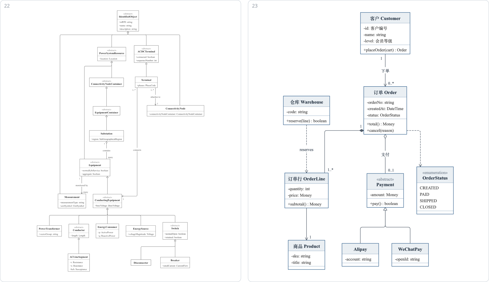</p>
<p align="center"><sub>22 <a href="examples/gallery/22-power-system.png">Power system model · report</a> · 23 <a href="examples/gallery/23-order-system.png">Order system</a></sub></p>

### ER diagrams

<p align="center">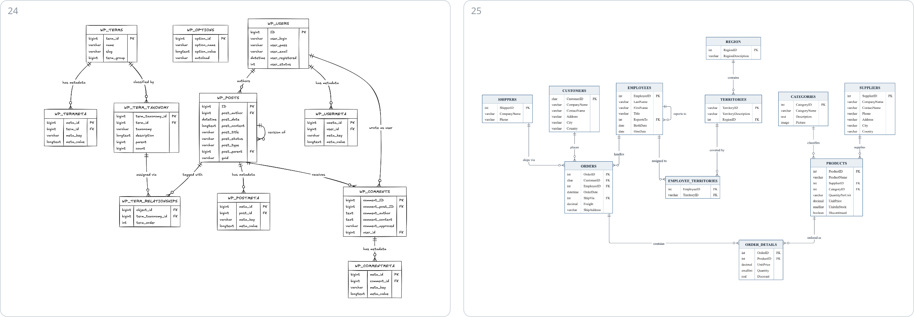</p>
<p align="center"><sub>24 <a href="examples/gallery/24-wordpress.png">Blog platform tables · hand-drawn</a> · 25 <a href="examples/gallery/25-northwind.png">Order management</a></sub></p>
<p align="center">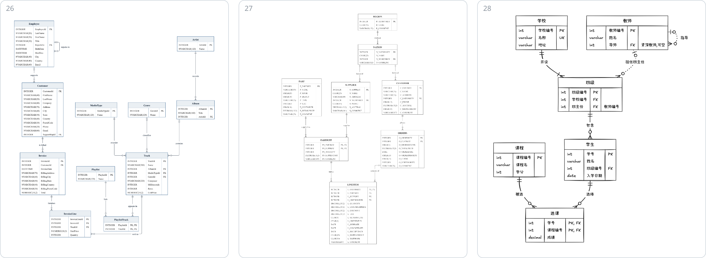</p>
<p align="center"><sub>26 <a href="examples/gallery/26-chinook.png">Chinook</a> · 27 <a href="examples/gallery/27-tpch.png">TPC-H · report</a> · 28 <a href="examples/gallery/28-school.png">School enrolment · hand-drawn</a></sub></p>
<p align="center">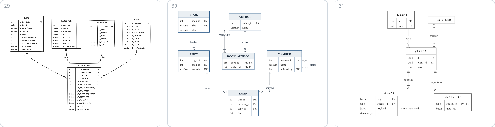</p>
<p align="center"><sub>29 <a href="examples/gallery/29-star-schema.png">Star schema · hand-drawn</a> · 30 <a href="examples/gallery/30-library.png">Library lending</a> · 31 <a href="examples/gallery/31-event-store.png">Event store · report</a></sub></p>

### Architecture diagrams

<p align="center">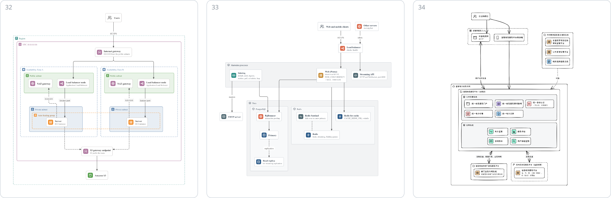</p>
<p align="center"><sub>32 <a href="examples/gallery/32-cloud-architecture.png">Cloud network · report</a> · 33 <a href="examples/gallery/33-service-architecture.png">Service deployment</a> · 34 <a href="examples/gallery/34-platform-architecture.png">Government platform · hand-drawn</a></sub></p>

### C4 model

<p align="center">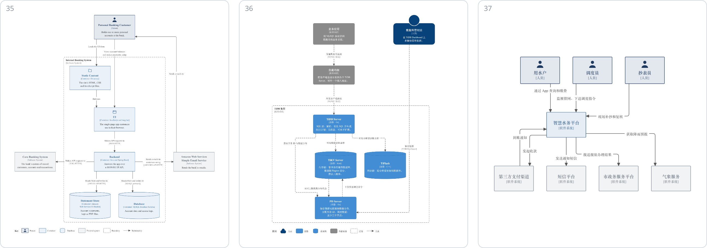</p>
<p align="center"><sub>35 <a href="examples/gallery/35-c4-containers-bank.png">Containers: internet banking</a> · 36 <a href="examples/gallery/36-c4-containers-tidb.png">Containers: a distributed database · report</a> · 37 <a href="examples/gallery/37-c4-context.png">System context</a></sub></p>

### Deal and contract structures

<p align="center">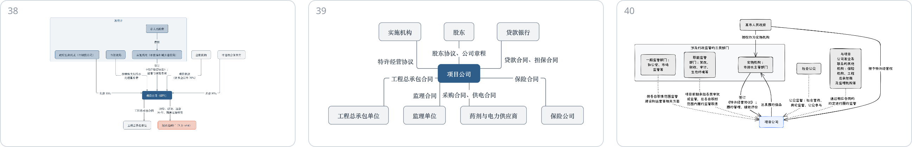</p>
<p align="center"><sub>38 <a href="examples/gallery/38-transaction-structure.png">Transaction structure</a> · 39 <a href="examples/gallery/39-contract-system.png">Contract system</a> · 40 <a href="examples/gallery/40-supervision.png">Supervision · hand-drawn</a></sub></p>

### Organisation charts

<p align="center">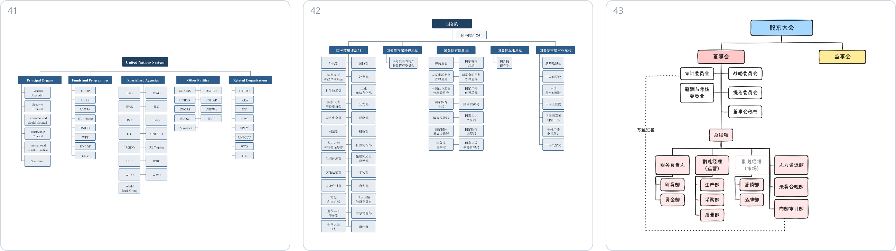</p>
<p align="center"><sub>41 <a href="examples/gallery/41-un-system.png">The UN System</a> · 42 <a href="examples/gallery/42-state-council.png">The State Council · report</a> · 43 <a href="examples/gallery/43-governance.png">Corporate governance · hand-drawn</a></sub></p>

### Mind maps

<p align="center">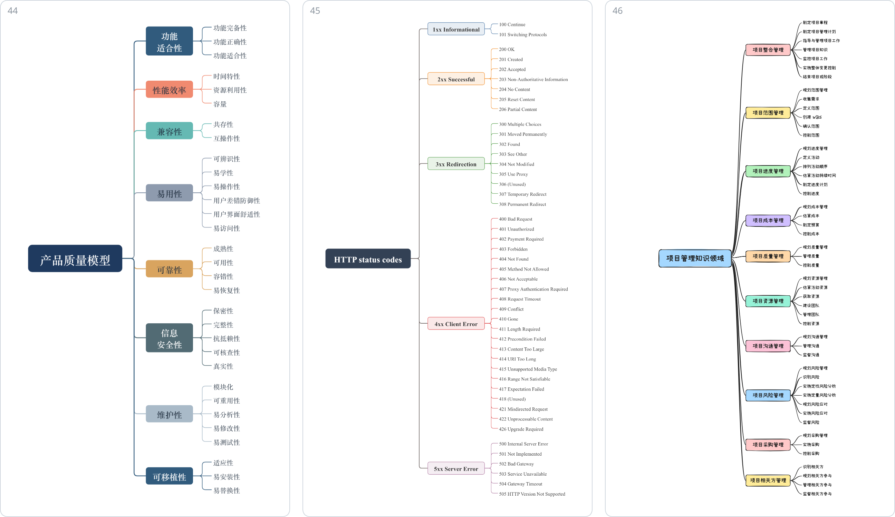</p>
<p align="center"><sub>44 <a href="examples/gallery/44-quality-model.png">Quality model</a> · 45 <a href="examples/gallery/45-http-status.png">HTTP status codes · report</a> · 46 <a href="examples/gallery/46-pmbok.png">Project management · hand-drawn</a></sub></p>

### Gantt charts

<p align="center">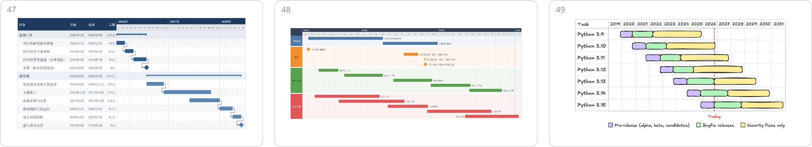</p>
<p align="center"><sub>47 <a href="examples/gallery/47-schedule.png">Implementation schedule</a> · 48 <a href="examples/gallery/48-space-station.png">Space station missions · report</a> · 49 <a href="examples/gallery/49-release-lifecycle.png">Release lifecycle · hand-drawn</a></sub></p>

### Timelines

<p align="center">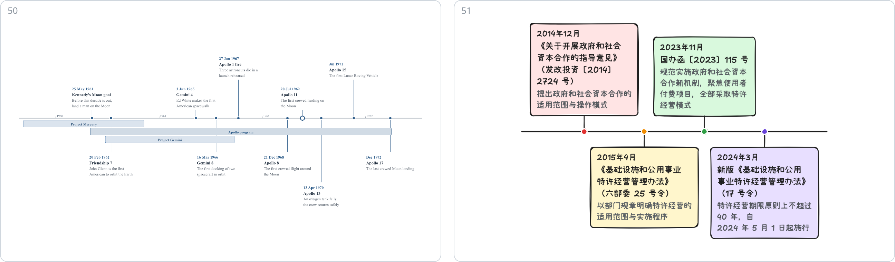</p>
<p align="center"><sub>50 <a href="examples/gallery/50-moon.png">To the Moon</a> · 51 <a href="examples/gallery/51-policy.png">Policy history · hand-drawn</a></sub></p>

### Fishbone diagrams

<p align="center">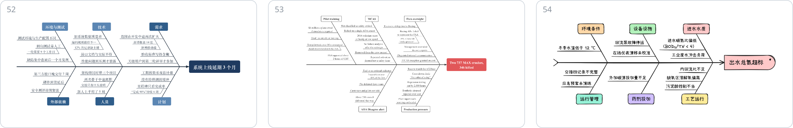</p>
<p align="center"><sub>52 <a href="examples/gallery/52-delivery-delay.png">Why delivery slipped</a> · 53 <a href="examples/gallery/53-crash-causes.png">The 737 MAX crashes · report</a> · 54 <a href="examples/gallery/54-total-nitrogen.png">Effluent over the limit · hand-drawn</a></sub></p>

### Risk matrices and quadrant charts

<p align="center">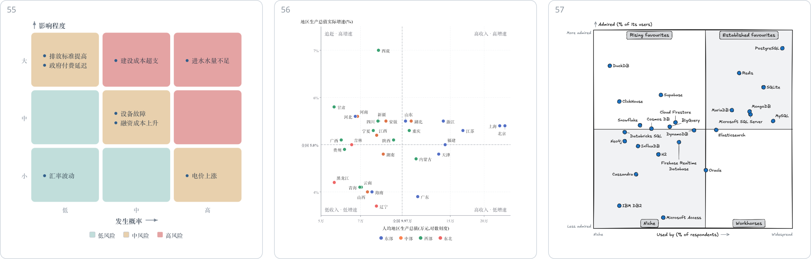</p>
<p align="center"><sub>55 <a href="examples/gallery/55-risk-matrix.png">Risk matrix</a> · 56 <a href="examples/gallery/56-provinces.png">Provinces in quadrants · report</a> · 57 <a href="examples/gallery/57-databases.png">Databases in quadrants · hand-drawn</a></sub></p>

### Sankey diagrams

<p align="center">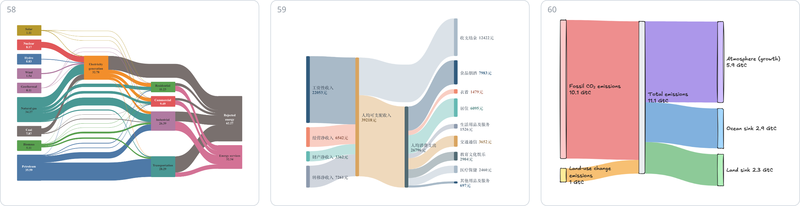</p>
<p align="center"><sub>58 <a href="examples/gallery/58-energy-flows.png">Energy flows · report</a> · 59 <a href="examples/gallery/59-household.png">Household income and spending</a> · 60 <a href="examples/gallery/60-carbon-budget.png">Carbon budget · hand-drawn</a></sub></p>

### Treemaps

<p align="center">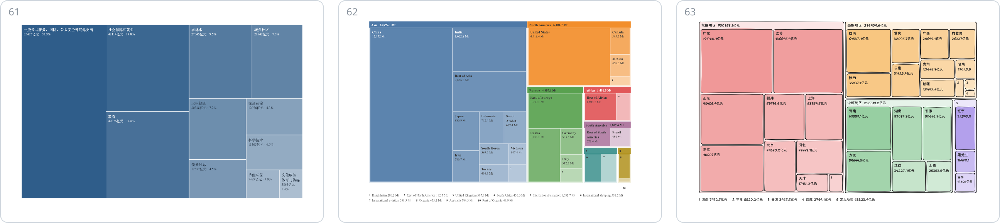</p>
<p align="center"><sub>61 <a href="examples/gallery/61-budget.png">Public spending</a> · 62 <a href="examples/gallery/62-emissions.png">Emissions by country · report</a> · 63 <a href="examples/gallery/63-provinces-gdp.png">GDP by province · hand-drawn</a></sub></p>

### Pie, donut and rose charts

<p align="center">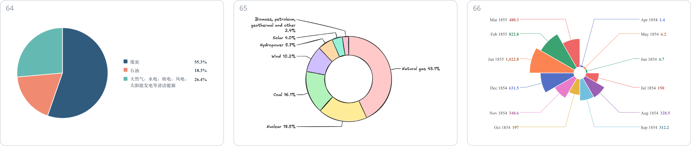</p>
<p align="center"><sub>64 <a href="examples/gallery/64-pie.png">Pie</a> · 65 <a href="examples/gallery/65-donut.png">Donut · hand-drawn</a> · 66 <a href="examples/gallery/66-rose.png">Rose chart · report</a></sub></p>

### Radar charts

<p align="center">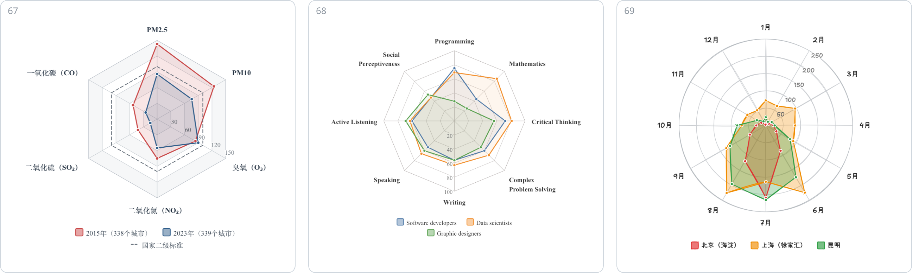</p>
<p align="center"><sub>67 <a href="examples/gallery/67-air-quality.png">Air quality</a> · 68 <a href="examples/gallery/68-skills.png">Skills by occupation · report</a> · 69 <a href="examples/gallery/69-rainfall.png">Monthly rainfall · hand-drawn</a></sub></p>

### User journey maps

<p align="center">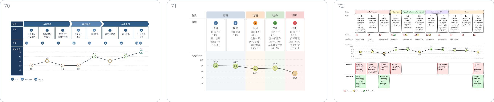</p>
<p align="center"><sub>70 <a href="examples/gallery/70-connection.png">Getting connected</a> · 71 <a href="examples/gallery/71-express.png">Parcel delivery · report</a> · 72 <a href="examples/gallery/72-benefit-claim.png">Claiming a benefit · hand-drawn</a></sub></p>

### Kanban boards

<p align="center">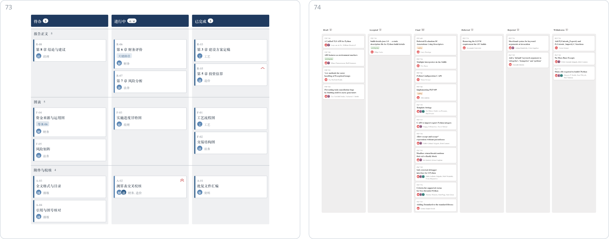</p>
<p align="center"><sub>73 <a href="examples/gallery/73-report-board.png">Report board</a> · 74 <a href="examples/gallery/74-peps.png">Proposals by status · report</a></sub></p>

### Requirement diagrams

<p align="center">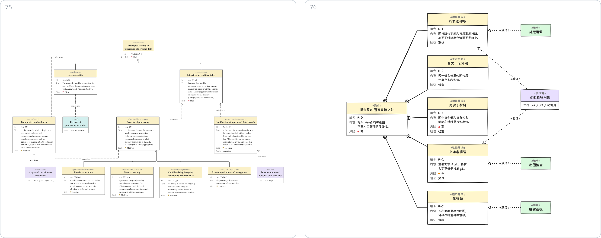</p>
<p align="center"><sub>75 <a href="examples/gallery/75-gdpr.png">Data protection duties · report</a> · 76 <a href="examples/gallery/76-report-requirements.png">Requirements for report figures · hand-drawn</a></sub></p>

### One figure, six document styles

<p align="center">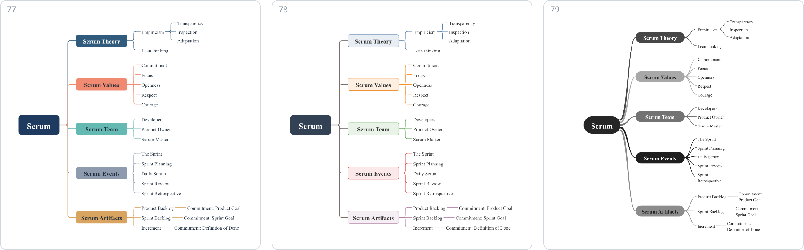</p>
<p align="center"><sub>77 <a href="examples/gallery/77-style-business.png"><code>business</code></a> · 78 <a href="examples/gallery/78-style-report.png"><code>report</code></a> · 79 <a href="examples/gallery/79-style-mono.png"><code>mono</code></a></sub></p>
<p align="center">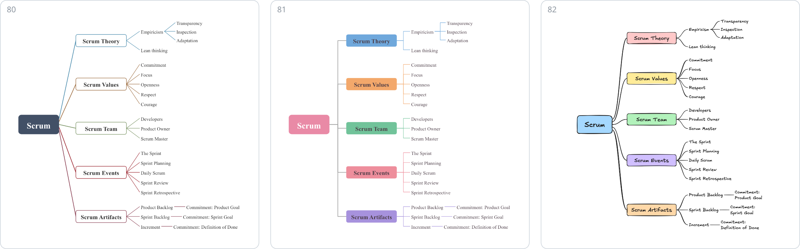</p>
<p align="center"><sub>80 <a href="examples/gallery/80-style-guofeng.png"><code>guofeng</code></a> · 81 <a href="examples/gallery/81-style-soft.png"><code>soft</code></a> · 82 <a href="examples/gallery/82-style-notebook.png"><code>notebook</code></a></sub></p>
<!-- /showcase -->

## Install

DiagramKit needs **Node.js 22.16 or later**.

### 1. Install the CLI

```bash
npm install -g @dztabel/diagramkit
diagramkit --version
```

Output like this means the CLI is installed:

```text
diagramkit 0.1.1 (contract 1)
```

### 2. Install one agent skill

The skill ships inside the npm package, so it always matches the installed CLI.

#### 2.1 Codex

```bash
diagramkit sync-skill --out ~/.agents/skills/diagramkit
```

Open Codex and type `$diagramkit`. If you can select the skill with `Tab`, it is ready. If it does not appear, press `Cmd+K` / `Ctrl+K`, choose `Force Reload Skills`, or reopen Codex.

#### 2.2 Claude Code

```bash
diagramkit sync-skill --out ~/.claude/skills/diagramkit
```

Open Claude Code and type `/diagramkit`. If you can select the skill, it is ready. If it does not appear, run `/reload-skills` and try again.

`sync-skill` writes into a new folder. When you update the CLI, remove the old skill folder first and run the command again.

## Quick Start

### 1. Add figures to a report the agent is writing

```text
$diagramkit Write the implementation plan as a Word report from my notes, and add figures where they help the reader: the approval process, the schedule, who signs what with whom.
/diagramkit Write the implementation plan as a Word report from my notes, and add figures where they help the reader: the approval process, the schedule, who signs what with whom.
```

### 2. Draw one figure from a passage

```text
$diagramkit Draw the payment procedure described in section 4 as a flowchart for the report.
/diagramkit Draw the payment procedure described in section 4 as a flowchart for the report.
```

### 3. Figures for slides

```text
$diagramkit Make the project organisation and the three-year roadmap as two figures for a 16:9 slide deck.
/diagramkit Make the project organisation and the three-year roadmap as two figures for a 16:9 slide deck.
```

### 4. Revise a figure

```text
$diagramkit In the process figure, split the review step into technical review and financial review, and build it again.
/diagramkit In the process figure, split the review step into technical review and financial review, and build it again.
```

The agent reads the material, decides what the figure says, writes its spec, builds it and checks the result.

## Technical Details

The agent writes a semantic JSON spec — what the boxes and relations are, never where they stand — and runs:

```bash
diagramkit validate figure.json
diagramkit build figure.json --out ./figure-1 --format png
```

DiagramKit lays the figure out, checks it (labels inside their boxes, relations clear of each other, text size on the page) and writes:

```text
figure-1/diagram.png            the figure, at its printed size
figure-1/diagram-manifest.json  the size to insert it at, and its caption
figure-1/diagram.html           a viewer page with an "edit" button
figure-1/quality.json           what was checked and what was found
figure-1/build-result.json
```

`--format all` adds `diagram.svg` and a vector `diagram.pdf`. `diagramkit example <name>` prints a complete spec for every figure type, and `diagramkit schema` the contract.

**Pages.** A figure is built for the page it goes on: a Word page by default (A4 portrait; landscape, A3 and custom text areas on request), a 16:9 slide with `--output ppt`, or a picture of its own with `--output standalone`. On a Word page the main text prints at 9 pt and never below 6.5 pt. A figure too large for its page is first laid out another way that fits; where none does, it is drawn at a readable size and reported as not fitting, with what would make it fit — a fold, a split at the boundaries of its content, a larger page. It is never shrunk until it cannot be read unless that is asked for.

**Look.** On a Word page a figure that names no style is dressed `business`: one colour family for the whole document, each figure type coloured in its own manner within it. Other document styles: `mono` (black-and-white print, official documents), `guofeng`, `soft`, `notebook` (hand-drawn) and `report` (each type's own regular look). Every type can also be drawn with the hand-drawn pen.

**Typefaces.** With no `--font`, a figure on a Word page is written in Times New Roman with the Song typeface the machine has (Songti SC on macOS, SimSun / 宋体 on Windows, Noto Serif CJK where installed), like the text of a report. A slide, a picture of its own, and any machine without a Song typeface use the bundled Noto Sans SC. `--font "Noto Sans SC"` asks for the bundled face everywhere — the same figure on every machine. The typeface a figure was drawn in is recorded in its `manifest.json`.

A PNG or PDF does not depend on the fonts of the machine that opens it. An SVG embeds subsets of the bundled faces only: opened in a browser on a machine without the Song typeface it is drawn in the embedded fallback, each line held to the width it was laid out in.

**Editing.** `diagramkit panel figure.json --open` opens a local panel in the browser to edit the figure's content and look; `diagramkit serve <folder>` serves a folder of figures and lets a built figure's viewer page open its panel. Both listen on this computer only.

## Troubleshooting

```bash
diagramkit doctor
```

`doctor` reports the Node version, the native renderer and the fonts in use — `font.wordPage` is what a figure on a Word page is written in on this machine.

- **`npm install` fails or `doctor` reports no native renderer.** DiagramKit draws with `skia-canvas`, which installs a prebuilt binary for the platform: macOS (Apple Silicon and Intel), Windows (x64 and ARM64) and Linux (x64 and ARM64). Before it is published, every release is installed fresh and draws a figure on macOS (Apple Silicon), Windows (x64) and Linux (x64).
- **`DKT001: Font is unavailable`.** A family named with `--font` is not installed. Leave `--font` out, or name an installed family.
- **Node is older than 22.16.** Install a current Node.js LTS.

When reporting a problem, include `diagramkit --version`, the output of `diagramkit doctor`, and a minimal spec that reproduces it.

## Repository Scope

This public repository contains the documentation, preview figures with their specs, and the release workflow.

The npm package contains the built command, the editing panel, the agent skill, the examples and the fonts with their licences. Source code, tests, the reference corpus and development documents are not included in the package or in this repository — see [`docs/public-boundary.md`](docs/public-boundary.md).

## License

DiagramKit is distributed through npm as a proprietary CLI in built form, free to install and use. Third-party components and fonts keep their own licences (`THIRD-PARTY-NOTICES.md` in the package). This repository provides the documentation and preview assets for installing and using the CLI.
